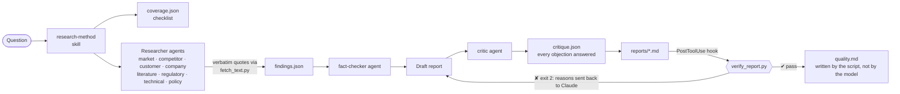

<div align="center">

# 🔎 verified-research

### Research you can audit. Every figure is checked against its source.

A **Claude Code plugin** for market, business, academic, legal and policy research in **any country and any language**.
Claude cites a source and a **verbatim quote** for every number, and a deterministic script opens each source page and
**rejects the report** if a figure is not really there.

[](LICENSE)
[](https://code.claude.com/docs/en/plugins)
[](tests/RESULTS.md)
[](#requirements)
[](https://github.com/Really-y)

**English** · [Azərbaycanca](README.az.md)

</div>

---

## ✨ Why

Ask an AI "*How big is the coffee market in Baku?*" and you will get a confident number. Often it has no source,
or the source says something else. **verified-research** turns that number into a finding you can check:

| Without the plugin | With verified-research |
|---|---|
| "The market is worth about 500 million." | `500 mln` → source URL → verbatim quote → **the script opens the page and checks the quote** |
| A blog post counts as much as the statistics office | Every source gets a **tier (1–6)**. A key figure from a weak source needs an independent second source |
| A three-year-old figure is presented as current | Data older than 2 years is **flagged** unless Claude explains why nothing newer exists |
| The conclusion is never challenged | A separate **critic** agent attacks the conclusion, and every objection needs a written answer |

## 🧭 How it works



The hook runs automatically every time Claude writes `reports/*.md`. If a figure is not found in its source, Claude
receives the exact reason and has to fix or remove it. After three failed attempts it must stop and show you the
failing figures instead of trying to make them pass.

## 🚀 Install

```text
/plugin marketplace add Really-y/verified-research
/plugin install verified-research@verified-research
```

Or for one session from a local clone:

```bash
git clone https://github.com/Really-y/verified-research
claude --plugin-dir ./verified-research
```

Then ask in any language:

> *How big is the organic food market in Germany?*
> *Which three Gulf countries are the best export targets for hazelnuts?*
> *Azərbaycanda son 3 ildə pərakəndə ticarət dövriyyəsi necə dəyişib?*

The report is written in the language of the question. You can also call the method directly with
`/verified-research:research-method`.

### Requirements

Python 3.9+ and [`pypdf`](https://pypi.org/project/pypdf/), because many statistics offices publish PDFs.
To keep the system Python clean:

```bash
python3 -m venv .venv && .venv/bin/pip install pypdf reportlab   # reportlab is only needed for the tests
PATH="$PWD/.venv/bin:$PATH" claude --plugin-dir ./verified-research
```

## 🧩 What's inside

<table>
<tr><th>Skills (11)</th><th>Agents (11)</th><th>Scripts</th></tr>
<tr valign="top"><td>

- `research-method` (entry point)
- `research-types`
- `source-quality`
- `source-map` (global + per-country)
- `research-tools`
- `market-research` (12-part checklist)
- `business-analysis`
- `target-markets`
- `competitor-watch`
- `critical-review`
- `report-template`

</td><td>

- `market-researcher`
- `competitor-researcher`
- `customer-researcher`
- `literature-researcher`
- `regulatory-researcher`
- `company-researcher`
- `technical-researcher`
- `policy-researcher`
- `fact-checker`
- `critic`
- `report-editor`

Researcher agents get **read-only** tools: web search and fetch, Read, Grep, Glob, and Bash for fetching
sources. Only `report-editor` can write files.

</td><td>

- `verify_report.py`: the verifier
- `fetch_text.py`: shows a source exactly as the verifier sees it (HTML, PDF, JSON), so quotes match
- `save_findings.py`: SQLite + CSV export
- `hook_verify.py`: PostToolUse hook

Standard library + `pypdf` only.

</td></tr>
</table>

### What the verifier enforces

- ✅ every figure appears **verbatim** in its quote, and the quote appears on the live source page;
- ✅ number formats from any locale: `1,234,567.89` · `1.234.567,89` · `58 997,7` · Arabic `١٬٢٣٤٫٥`, Persian `۴۵٫۷` and Devanagari `३४५` digits;
- ✅ a source tier is recorded for every fact, and known domains (`trusted_domains.txt`) cannot be inflated;
- ✅ **key figures** come from an official or international source, or are corroborated by an **independent** second source. A different domain is required, a copied quote is rejected, and shared hosts such as `*.blogspot.com` are handled;
- ✅ sources that disagree by more than 10% need an explanation, and both numbers are shown;
- ✅ stale data is flagged, estimates are marked (`ESTIMATE`) and need a formula and inputs;
- ✅ coverage per research type: every type (`market`, `business`, `target_markets`, `company`, `academic`, `legal`, `technical`, `policy`, `due_diligence`, or a mix such as `["market", "legal"]`) has its own mandatory checklist (12 dimensions for a market study, 6–8 for the others), and each gap names at least two places that were searched;
- ✅ critique: at least 3 objections, a counter-case, the weakest assumption, and a written response to each objection.

It also detects JavaScript-only pages instead of silently failing, reads quotes from Next.js data blobs, and
tolerates PDF text where extraction splits words (`pə rakəndə`).

## 🌍 Sources

[`skills/source-map/references/global.md`](skills/source-map/references/global.md) lists about 30 international sources.
Each one was **tested in November 2026** and has a status: *works* (with format: HTML / PDF / API), *registration needed*
or *unreachable*. Examples: World Bank API ✔, Eurostat API ✔, UN Comtrade preview API ✔, OpenAlex / Crossref / PubMed ✔,
SEC EDGAR JSON ✔, IMF ✘ (blocks automated requests), Google Trends ✘ (robots.txt). `robots.txt` is respected.

A ready-made country map exists for **Azerbaijan** ([`AZ.md`](skills/source-map/references/countries/AZ.md)). For any
other country, the agent discovers the primary sources on first use (statistics office, central bank, customs,
company registry, legal database) and saves them to `research-data/sources/<ISO2>.md` in your working directory.

## 📊 Dashboards & monitoring

- **Looker Studio / Google Sheets:** every run exports `reports/<name>.csv`, and `data/research.db` keeps the history.
  Step-by-step instructions are in [README.az.md](README.az.md#looker-studio-ya-csv-qoşmaq).
- **Weekly competitor tracking:** use `/schedule` (cloud), a Desktop scheduled task, or a system `cron` job with headless
  `claude -p --plugin-dir …`. A ready `watch.sh` + crontab line is in [README.az.md](README.az.md#dövri-monitorinq-həftəlik-rəqib-izləmə).

## 🧪 Tests

```bash
claude plugin validate . --strict
bash tests/run_tests.sh          # 61 checks: local web server as fake "sources", real DSK PDF text, hook exit codes
claude plugin eval . --allow-tools WebSearch WebFetch Write Edit Bash   # 9 real research cases, with vs without plugin
```

What has been proven in real Claude Code sessions, and what has not, is written down honestly in
[`tests/RESULTS.md`](tests/RESULTS.md).

## ⚠️ Limitations

- The script proves that a figure **is on the source page**. It does not prove that the source is right, or that the quote refers to the same indicator, country and definition. The `fact-checker` and `report-editor` agents check that, and so should you.
- Pages that only render with JavaScript cannot be verified unless their data is embedded in the HTML. Use a static page, PDF or API.
- Some PDFs have broken font encoding (for example, Azerbaijani headings in DSK yearbooks). Numbers still verify, but text quotes may not.
- Analysis, scores and recommendations are judgement, not verified fact. Medical, legal, tax and investment decisions belong to a professional.
- No personal data about private individuals is collected.

## 📜 License & attribution

Copyright © 2026 **Yusif Ezizov / Azedev**. Licensed under the [Apache License 2.0](LICENSE).

If you use, fork, modify or redistribute this project, you **must**:

1. keep the [`NOTICE`](NOTICE) file and the copyright line;
2. credit the original author visibly: *"Based on verified-research by Yusif Ezizov / Azedev (https://github.com/Really-y/verified-research)"*;
3. mark every file you changed.

<div align="center">
<sub>Built with care by <a href="https://github.com/Really-y">Yusif Ezizov</a> · Azedev</sub>
</div>
